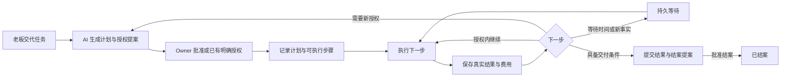

# EmergentInc V32 — 任务驱动 AI 公司、双入口审批制整改执行 PLAN

日期：2026-10-15

源码核查基准：`develop` / `23ae8786fe76d3a00198c0fc617e4c184dbd2d5e`

文档状态：主体实现、离线验收、本地提交及正式候选完整校验已完成；真实收费模型纵向验收仍待当次金额授权，整体计划尚未结项。准确候选身份与验收证据见 [V32 执行报告](EmergentInc_V32_执行报告.md)。本文不授权跳过正式软件发布审批。

## 0. 本版目标和执行纪律

**老板交代任务，AI 拆解、安排和持续推进；员工汇报真实结果，老板通过对话跟进、停止，通过审批结案。**

本版只围绕三条主线：

1. OWNER 只保留「Boss 对话」「AI 公司看板」，所有经营操作统一为对话和提案审批。
2. 发布升级只保留双 Git 树和一条「选择提交 → 批准切换」流程。
3. 取消业务 Token 配额，只保留公司金额总预算，由 AI 安排资源使用。

执行前读取 `AGENTS.md`，核对 Git 状态、最新提交及真实 schema。复用现有服务和事实记录，不覆盖用户更改，不开启 subagent。新增、修改、删除的页面内容同批更新中英文。

本计划取代 V31 中以下产品策略：千万 Token 自动续批、十亿累计 Token 授权上限、OWNER 多栏目及手工控制表单。其他与本版无关的认证、证据核验、未知结果处理、付款核验、数据隔离和发布完整性规则继续有效。

**不能只把旧设置藏起来。** 需要合并重复的任务入口和执行门槛，让同一任务只拥有一份权威状态、一条调度路径、一份费用记录。也不建设新的通用编排平台、可视化流程编辑器、插件市场或规则 DSL。

## 1. 已核对的代码事实

| 位置 | 当前事实 | 本版处理 |
| --- | --- | --- |
| `frontend/src/features/owner/OwnerConsole.tsx` | 仍有公司、目标、Boss 对话、待办、历史五个导航入口 | 合为对话与看板两个入口，旧深链接映射到对应看板内容 |
| `apps/server/src/services/owner_chat_service.ts` | 短任务走 dispatch，持续目标走 create_goal，商品操作另有分支 | 新经营任务统一建立任务记录；现有执行器作为任务步骤执行器 |
| `owner_goal_service.ts` | 已有目标、版本、事件、步骤、派工、证据、人工验收和幂等缓存 | 作为唯一公司任务主记录，补齐计划、触发规则和循环运行记录 |
| `owner_goal_scheduler.ts` | 已有恢复、轮转、无进展判断；目前主要按目标派工，回复后通常进入待验收 | 改为按持久计划推进节点，不把一次回复当成整个组合任务结束 |
| `owner_goal_steps` / `owner_goal_dispatches` | 现有步骤偏向执行尝试，与派工有一对一引用 | 保留历史主键；逻辑工作节点与执行尝试明确关联，不能直接改名冒充完整工作流 |
| `packages/protocol/src/types/business_schedule.ts`、`business_store.ts` | 已有间隔/每日调度、到期去重及离线不集中补跑，但属于另一条 BusinessPlan 路径 | 复用时间计算和去重原则；Owner 新任务不再建立第二套独立经营计划 |
| `goal_outcome_evaluator.ts` | 能核验产物和付款；部分验收可直接把目标标为 COMPLETED | 核验负责证明步骤事实，整个任务结案交给 Owner |
| `owner_automation_gate.ts` | 已有公司开关、许可、Token 续批及费用统计；费用统计尚不等于金额预算闸门 | 改为公司金额预留与结算的统一闸门，Token 保留为用量 |
| `owner_actions.ts`、`OwnerActionCard.tsx`、`OwnerInbox.tsx` | 已有多类审批投影及对应业务执行器 | 统一提案展示与决策协议，继续调用已有领域执行器 |
| 人物 role / behaviorProfile | 有角色资料；未发现独立秘书编排契约 | 秘书为可选的协调与汇报角色，编排能力不依赖某个人物存在 |
| `resources/upgrade-web.html`、`scripts/upgrade-web.mjs` | 双 Git 树之外，还有准备、重校验、发布、回退、删除等多条操作路径 | 收敛成一个目标提交和一个发布流程 |
| `scripts/version-upgrade.mjs` | 所选提交准备要求 main 可快进，发布还绑定 main 同步 | 将运行版本切换与 Git 分支变更解耦，支持兼容提交间前后切换 |

以上是源码事实，不代表本版能力已经实现。执行时再次核对，不按本文臆造现有字段或接口。

## 2. 主线一：OWNER 双入口与任务执行循环

### 2.1 页面与操作契约

左侧导航严格只有：

- **Boss 对话 / Boss chat**：交代任务、查看汇报、补充资料、追问、调整目标、暂停、停止、继续和要求结案。
- **AI 公司看板 / AI company dashboard**：查看公司真实状态和处理提案。

看板是一个页面，按信息重要性排列以下区域，不再新增同级导航：

| 区域 | 展示形式 | 数据要求 |
| --- | --- | --- |
| 待我审批 | 提案卡片，默认置顶 | 说明要做什么、原因、费用/影响、批准后动作；只有「批准执行」「拒绝」两个决策按钮 |
| 任务与进展 | 状态分布、任务卡片、阶段时间线 | 展示当前步骤、负责人/执行者、最近真实进展、下一步、下次触发时间 |
| 经营结果 | 产物卡片、可核验的收入趋势 | 直接查看交付物和来源；内部草稿、订单、实收分别表述 |
| 公司预算 | 总授权、已花费、已预留、可用金额及趋势 | 来自同一费用账本，不以 Token 或元胞能量换算余额 |
| 人员与工作 | 工作负荷图、当前分工 | 无秘书也能展示协调服务与实际执行者，不编造员工或忙碌状态 |
| 汇报记录 | 任务时间线与只读详情 | 与对话里的任务、提案和执行回执使用同一 ID |

图表必须对应真实可用的数据；没有数据时显示空态，没有确定完成比例时展示阶段状态，不编造百分比。

移除 OWNER 内的 Token、轮数、坐标、人员数量加减、手动分配资源、编辑验收 JSON 等设置入口。现有任务、待办、历史、人员、商品、费用、异常信息汇入看板详情；详情展开和查看产物不是新的决策按钮。

`/QIAN`、`/YUAN`、`/GENE` 的普通经营控制不再成为完成 Owner 任务的必经步骤。工程诊断可保留只读入口，必要的认证/凭据交付继续使用既有安全入口，不将密钥送进模型上下文。8766 维护独立保留，按主线二简化。

运行/暂停由对话表达，状态在看板可见。正在停止时显示真实 STOPPING，不在仍有执行中的动作时提前宣称停止完成。

暂停、停止、审批、读取已记录状态及明确金额的预算授权等控制请求不依赖收费模型；预算耗尽或维护期间仍能处理。作用对象不明确时只澄清对象，不能默认停止全部任务。登录/退出和语言切换属于基础界面，不增加经营导航。

### 2.2 统一任务语义

「模块」指可执行、可核验的工作单元，不是新建一个软件服务。

一个公司任务包含：老板原始要求、当前计划版本、完成标准、授权范围、工作节点、触发规则、执行记录、证据和审批记录。一次性、长期、定时不是三个互斥系统：

- 一次性任务：满足步骤条件后执行，交付结果等待 Owner 结案。
- 长程任务：根据新事实持续推进、调整后续步骤，直到达到结案条件或 Owner 停止。
- 定时任务：按已批准时间规则生成执行批次；每批可包含多个步骤。
- 组合任务：同一任务中可先做一次性准备，再周期采集，再长期改进，并定期汇报。

任务级状态面向 Owner 统一为：**待批准、待执行、执行中、等待条件、待验收、已结案、已停止**。后台保留暂停、未知结果、资源不足等准确原因；前端不能把所有阻塞都标成执行中。

### 2.3 一次授权，范围内持续推进

老板交代需求后，AI 生成简短的可执行提案：目标、主要步骤、完成标准、费用安排、定时规则及必要的外部动作。普通计划通过一次审批后持续执行，后续内部拆解和派工不逐步求批。

**已经明确的 Owner 授权可以直接作为审批证据。** 例如「按这个计划执行」「批准这项任务」「把这个商品改成 19.9 并上架」绑定明确对象和内容后，不再重复要求同一动作的第二次确认。普通询问、历史聊天、员工回复和检索内容不算新的批准。

以下情况形成新提案：新增公司预算、超出已授权范围、需要新增人员/权限、外部写入缺乏明确授权、改变已批准的关键目标或参数、请求结案。

初始提案可以明确授权后续站内商品动作和自主定价范围。范围已覆盖的动作按计划执行；不能从「提高收入」推导出任意价格、任意外发或软件发布权限。

批准和执行必须有清楚的时间顺序：批准后可显示「已排队」「正在执行」，只有真实回执成功后才显示「已完成」。拒绝不执行该提案，不自动换一种说法重新请求同一授权。

### 2.4 AI 执行循环



实现要求：

1. **AI 负责决策，代码负责落实。** AI 输出结构化步骤、依赖、工具需求、预期证据和下一步；服务端校验后落库。实际工具必须来自已有能力清单，不允许模型任意执行命令或调用不存在的工具。
2. **一个任务一个权威计划。** 复用 `OwnerGoalService` 及计划版本；`OwnerGoalScheduler` 是 Owner 任务的唯一推进者，`OwnerWorkService` 承担实际派工。旧 BusinessPlan 中仍在运行的记录通过引用适配进入同一视图，不能迁移后被两个调度器重复执行。
3. **区分逻辑节点、触发批次和执行尝试。** 在当前 goal/revision 结构上补齐最少关联；必要时增加小型节点/批次表。保留现有 step、dispatch、permit 的历史主键和审计链，不另造第二个顶层任务系统。
4. **持久化后执行。** 计划、下一次唤醒、派工意图、动作幂等键和执行回执先后有序落库。重启后从未完成步骤继续，不能重新规划并重复已完成的动作。
5. **按事件推进。** 模型只在需要规划、处理结果、判断新情况时调用；定时轮询本身不调用模型。等待时间、审批或外部回执时休眠，不做无意义的收费循环。
6. **无进展要改变处理。** 利用产物 Hash、步骤结果、工具回执识别真实进展；重复空回复不算进展。已有无进展保护改为给出原因和可行动提案，不能无限重试消耗预算。
7. **修改及时失效。** Owner 调整目标、拒绝提案、暂停或停止后，使受影响的旧计划/审批版本失效。已发出的动作保留真实结果，后续未发出的动作不得继续。
8. **结案归 Owner。** 产物存在、付款已核验可以完成相应步骤，不能自动等价于整个任务结案。Owner 批准结案后停止该任务后续触发；拒绝结案只拒绝关闭，等待对话反馈或新的跟进指令。

授权范围版本与内部计划版本要区分：AI 在既定目标、费用和权限范围内调整步骤顺序，只产生新的计划版本及记录，不要求重新批准整个任务。扩大权限或改变关键承诺才更新授权范围版本。沿用现有 specification revision 表达授权边界，避免每次重规划都废掉整个任务。

结案提案由系统绑定当前成果版本和证据 ID，Owner 无需填写验收 JSON 或技术原因；纯文本成果也应留存为可查看的版本化产物。人类认可交付不能伪造付款回执。

首版计划支持普通依赖关系和分支汇合，不提供图编辑器。逻辑图必须有限、引用有效且无依赖环；长期执行通过显式的批次/迭代继续，不用循环依赖伪装成计划。

### 2.5 定时与组合任务的明确规则

- 复用现有间隔、每日时间计算；补充每周/指定星期即可覆盖首版常见需求，不引入任意 cron DSL。
- 时间规则和时区必须在提案里用自然语言展示；本机默认 `Asia/Shanghai`，涉及其他时区时明确展示。
- 幂等键包含任务、计划版本、节点及计划触发时刻。同一批次多进程争抢只生成一次执行。
- 默认同一定时节点不重叠执行。上一次未结束时合并到一次待执行，不无限积压。
- 离线错过的触发默认合并为一次，汇报漏掉的时间范围，不伪造当时已执行，也不补跑几十次。
- 周期任务的某一批交付完成，不自动关闭整个长期任务。单次成果审批和整个任务结案分别绑定对象。
- 复合任务中部分节点待审批时，已获授权且不依赖该审批的节点仍可继续；停止根任务则取消所有未来触发。
- 根任务状态由节点情况汇总；不能因为一个子提案待审批，就沿用旧全局 WAITING_APPROVAL 门槛冻结所有独立节点。
- 不沿用「最多运行 366 次」作为长期任务的默认业务上限。停止依据是 Owner 指令、计划结束条件、金额预算或真实异常。

### 2.6 秘书可选

有秘书时，由其承担协调和汇报的角色表达；没有秘书时，由公司编排服务完成同一套流程。秘书离职、停用或更换后，任务和计划仍然存在。

复用已有角色和行为资料，必要时用一个可选的协调者引用绑定人物。不能同时让“系统编排器”和“秘书”分别规划、重复派工和重复收费。

没有合适执行人员时生成招聘提案，不能凭空宣称已有员工执行。是否设置秘书不影响任务能否进入规划、审批与等待资源状态。

### 2.7 提案的最小公共契约

提案至少绑定：提案 ID、类型、源任务/版本、准确动作参数、内容 Hash、说明、费用影响、状态、Owner 决定、执行幂等键和结果引用。

优先复用 `owner_actions.ts` 的领域动作和 `owner_control_requests` 的幂等能力；现有招聘、资源、商品、验收等事实仍以各自执行器为准。仅为缺少持久决策/执行记录的动作增加统一提案存储，不建设规则引擎。

批准时同时校验当前任务版本、参数 Hash、对象状态和已有授权。两次点击、两个窗口或进程重启都只能驱动同一执行意图。决策和执行之间失败时，可从持久记录恢复，不要求 Owner 再次批准原动作。

未知外部结果需要先核实回执。审批不能把未知结果变成成功，也不能直接触发可能重复的外部动作。

## 3. 主线二：双 Git 树与单流程版本切换

### 3.1 页面契约

保留双 Git 树、提交说明、当前实际运行版本和唯一的目标提交。选择提交后自动准备并显示进度；通过校验后只有一个主按钮：**批准并切换 / Approve and switch**。

页面流程为：

```text
选择提交 → 自动准备与校验 → 批准并切换 → 启动验证 → 显示当前版本
```

删除单独的版本标签/理由填写、准备按钮、重校验按钮、历史回退表单、删除发布、删除后续版本、合并 main 等常规产品操作。版本名称和说明来自所选提交，技术日志默认折叠。

选择旧提交也走同一条流程。选择操作本身不发布软件；批准绑定的是准备完成的准确候选，界面无需让用户手工复制 Hash。

### 3.2 必须同时解除后台耦合

1. `preparePinnedCommit()` 只准备已存在、准确固定的 commit；取消“必须是 main 的快进后代”作为软件切换的条件。
2. 发布不自动移动 main/develop，不重置开发工作区。双树保留分支含义，另标记实际运行提交，不能用 main 指针冒充运行版本。
3. 在隔离 checkout 中构建候选，复用现有冻结、验证、批准、迁移和健康检查。选择其他提交不修改正在运行的冻结目录。
4. 回到旧源码也生成单调递增的新运行代号，使用当前业务数据进行兼容迁移；不能通过恢复旧数据库来实现“切换旧版本”。
5. 不兼容当前数据/schema/技能/扩展/金额预算协议的提交不可发布，显示具体原因。Git 中存在提交不等于该提交能读取当前数据。
6. 同一源提交只有在依赖、构建身份、当前基线、资产和兼容性条件匹配时才复用候选；审批 Hash 不跨候选复用。速度优化不能简化成“测过这个 SHA 就永远跳过检查”。
7. 切换时保存 Owner 原本的运行/暂停意图。发布成功不自动解除人工暂停或维护恢复暂停，也不增加预算。
8. 运行发布、批准数据库和配置固定放在 `owner_private/approved-runtime` 等持久目录，不能再依赖可清理的 `cache`。当前恢复实例使用此目录，必须兼容其有效批准凭据。

初始恢复版本若没有普通候选的 source_commit，显示真实的“恢复快照”来源；不能猜测或伪造其提交来源。后续按提交发布的版本必须保存准确 source_commit。

独立管理员 CLI 可保留必要的中断恢复能力；删除/危险维护入口不留在简化页面，也不通过 World 工具绕开 Owner 批准。正常功能验收不要求用户使用 CLI。

## 4. 主线三：Token 只计量，公司只管理一笔金额预算

### 4.1 产品与账务语义

“无限 Token”的实现是：**不再设置公司、目标、人员、Run 的业务 Token 授权额度；在公司金额预算允许的范围内持续执行。**

公司只保留一笔人民币累计授权金额，沿用现有 CNY 计价基础。该预算按 V32 首次金额授权生效时固定的起点累计；更早的已结算历史另行只读展示。预算通过对话生成提案、批准后生效。AI 决定任务优先级和内部资源安排，不能自行扩大总预算。

```text
可用金额 = 总授权金额 − 已结算费用 − 有效预留金额
```

内部任务分配是调度计划，不新增一套需要 Owner 管理的部门/人员/步骤硬预算。没有明确的预算周期指令时，不自动每月重置、不自动续费或续批。

商品 USDT 价格和真实收入保留原币种；不能把未核验收入或未经确认的汇率换算成可花费预算。公司费用预算不是钱包付款授权。

### 4.2 最小实现与覆盖范围

- 金额使用整数微元（`1 CNY = 1,000,000 micros`），复用现有业务金额语义；不可直接用浮点累加做预算判定。
- 以 `OwnerAutomationGate` 为公司统一调用闸门，扩展现有 model permit 的费用预留/结算字段，复用已有 operation/call ID 去重。业务账本和运行账本只投影同一事实，不能重复扣费。
- 调用前按输入和本次输出上界、有效价格预留费用；结算后释放多余预留。并发预留必须原子化，不能两个步骤同时花掉同一余额。
- 覆盖 Owner 对话、AI 规划、秘书协调、World 推理、会议/招聘模型调用、Dream 和 BusinessService 等实际可达调用路径；每条路径记录调用者和源任务。不能留下不经过公司预算的旁路。
- 非模型的已知收费工具同样需要费用许可；没有收费能力或凭据的外部动作，不因预算存在而获得执行权限。
- 保留模型上下文长度、单次输出限制和单次执行切片。这些是内部技术边界：切片结束后由任务循环接续，不让老板填写或不断点击续跑。
- 消除 Owner 任务因旧 Run Token、轮数或入口能量而要求人工加减的路径。入口补能复用现有能力并纳入任务授权；不把它扩展成任意元胞无限资源或无预算调用。
- 未知计费保留预留并阻止受影响的新支出；无法可靠估价时提出需要资料/核验的事项。预算不足产生金额提案，不能把未知金额当 0，也不能自动补钱。

明确停止使用 `ensureAutoQuota()` 的千万续批作为经营授权依据，移除十亿累计 Token 业务上限；不能把它改成一个更大的数字或 `Infinity` 充当整改完成。

### 4.3 初次启用和旧数据迁移

没有金额授权时，不调用收费模型来猜预算。通过不调用模型的引导，要求 Owner 用一句话提供金额，例如「公司预算 100 元」；生成准确预算提案。明确说“批准公司预算 100 元”可作为该笔授权本身。

旧 Token 授权不能按某个模型的当前单价直接换算成人民币。启用 V32 时固定金额授权起点并快照旧费用事实：此前已结算费用只展示为历史，不再次消耗新预算；未结算调用必须先核清，或将有可靠上界的待结算责任明确带入预留，只有结算后才释放。无法确定上界时不能自动启用收费任务。预算、预留和费用统计采用相同范围，避免重复扣费或遗漏旧责任。

旧 Token 字段暂时只读保留，旧 API 的额度写入关闭或明确报需升级客户端，不能悄悄继续使用另一套额度闸门。人工 OFF、停止、维护暂停和结果未知状态原样继承。

## 5. 实施顺序与文件范围

每阶段先通过对应验收，再进入下一阶段；不要先删除唯一可用入口再补后台。

| 阶段 | 必须交付 | 主要代码锚点 |
| --- | --- | --- |
| S0：统一事实与契约 | 任务/计划/批次/执行尝试映射；审批与费用口径；旧入口迁移清单及数据备份 | `packages/protocol/src/types/owner.ts`、现有 Owner/Business 持久化结构 |
| S1：金额与提案闭环 | 对话提出预算；一次批准即驱动执行；统一金额预留/结算；所有可达收费路径接入 | `owner_automation_gate.ts`、`owner_actions.ts`、`owner_routes.ts`、`BusinessStore`、模型调用适配层 |
| S2：单任务到组合循环 | 同一任务跑通规划→执行→证据→下一步→汇报→Owner 结案，再扩展定时和组合触发 | `owner_chat_service.ts`、`owner_goal_service.ts`、`owner_goal_scheduler.ts`、`owner_work_service.ts`、`goal_outcome_evaluator.ts`、调度时间函数 |
| S3：OWNER 双入口 | 两个导航、统一看板和审批卡；删除经营设置；兼容旧深链接；中英同步 | `OwnerConsole.tsx`、`OwnerChat.tsx`、Owner 看板/卡片、`owner_overview_service.ts`、`owner.css`、双语字典 |
| S4：提交切换单流程 | 双树选提交、自动准备、一键批准切换；解除 main 快进/同步耦合 | `resources/upgrade-web.html`、`scripts/upgrade-web.mjs`、`scripts/version-upgrade.mjs`、现有 Supervisor/兼容性检查 |
| S5：清理与整体验收 | 退出重复调度/写入口；验证升级与重启；同步 README/指南/实施报告；准备正式候选 | 仅清理本版确认已无调用者的旧代码和测试 |

可按实际依赖合并小步骤，但不能为了前端演示绕过 S1/S2。新增服务或表必须说明当前结构缺少的事实以及调用者；不建设第二个中央公司控制器。

本版新增 schema 应集中版本化迁移并有备份。旧目标、已批准任务、历史派工、产物、订单、付款、未知调用均保留。旧任务迁移后不能自动获取新增预算、权限或重新执行。

## 6. 必须通过的验收场景

| 场景 | 必须观察到的结果 |
| --- | --- |
| 没有秘书 / 更换秘书 | 同一任务仍能规划、执行和汇报，状态不丢失，不重复派工 |
| 一次性任务 | 一次授权后执行，附实际产物提交结案；Owner 批准后才成为已结案 |
| 长程多阶段任务 | A 的真实产物被 B 使用，B 的结果驱动 C；一次回复和一次 Run 结束不终止整个任务 |
| 组合任务 | 「先调研制作，按授权上架；每天采集反馈，持续改进，每周汇报」使用同一根任务，可追踪每个触发批次和证据 |
| 定时去重 | 重启、两个调度进程、重复 tick 不重复生成同一批次；跨时区/夏令时行为可解释 |
| 离线与积压 | 离线期间不伪造执行，恢复后默认只合并一次；前一批未完不并发堆积 |
| 审批幂等 | 双击、两个窗口和批准后崩溃恢复只执行同一意图；修改过内容的提案不能沿用旧批准 |
| 拒绝与范围 | 拒绝无副作用；AI 在已批准范围内自行派工，扩权/加预算须新提案 |
| 结案与停止 | 拒绝结案不把任务关闭；停止根任务阻止后续节点及定时触发；已发出动作保留真实回执 |
| 无进展和未知结果 | 空转被识别；未知外部结果不会自动重发，审批不能制造成功证据 |
| 金额并发与扣费 | 多路径竞争剩余预算不超额预留，同一调用只结算一次；失败/未发送/未知分别处理 |
| 不再被 Token 卡住 | 足够金额下跨旧千万批次、旧十亿总数、Run 切片仍能接续；无需手动加 Token/轮数 |
| 暂停与恢复 | 人工停止后定时器、重启、角色变更和软件发布均不擅自恢复经营 |
| 双入口与中英 | OWNER 恰好两个左侧入口，没有经营设置表单；任务、提案、费用状态两种语言一致 |
| 提交来回切换 | 两个支持当前数据的提交 A→B→A→B 成功，业务数据持续保留，main/develop 不被移动 |
| 旧提交不兼容 | 清楚显示不兼容原因，当前程序及新业务事实保留，不恢复旧数据库来掩盖问题 |
| 发布竞态与恢复 | 选中 SHA、候选 Hash、当前实例版本变化时拒绝过期批准；中断后有真实状态和恢复路径 |
| 持久发布资料 | 清理普通 cache 后仍可校验和启动批准版本；不删除 owner_private 或工作区备份 |

至少完成一次带真实模型的本地纵向验证：老板交代组合任务 → AI 形成计划 → 一次批准 → 自动推进两个依赖步骤 → 在重启后继续 → 定时批次触发 → 实际成果汇报 → Owner 结案。没有秘书也要跑通。收费预算和外部动作依当次明确授权执行；集成测试使用的模型/时钟替身必须如实标注。

正式发布前运行类型检查、对应专项测试、全量测试、服务端和前端构建、真实进程迁移/重启/版本切换验收。记录通过、跳过和未验收项；测试不能证明真实客户付款或未经执行的外部业务成功。

## 7. 完成定义

Owner 能只用对话与审批完成一项从交代到结案的任务；能看到公司在做什么、做到哪里、花了多少、哪里需要决定。有无秘书不影响执行循环。普通操作不要求理解 Token、轮数、元胞坐标、计划 JSON 或发布内部阶段。

发布升级能在兼容提交之间沿同一流程前后切换。后台保留必要的状态和校验，但不向 Owner 暴露重复控制入口。

实施报告必须列出：删除/合并的入口及调用链、唯一权威任务与费用事实、迁移证据、审批执行回执、循环推进与重启证据、双语页面结果，以及正式候选的准确身份。**仅改页面导航、仅隐藏设置、仅放大 Token 上限，均不算完成 V32。**
