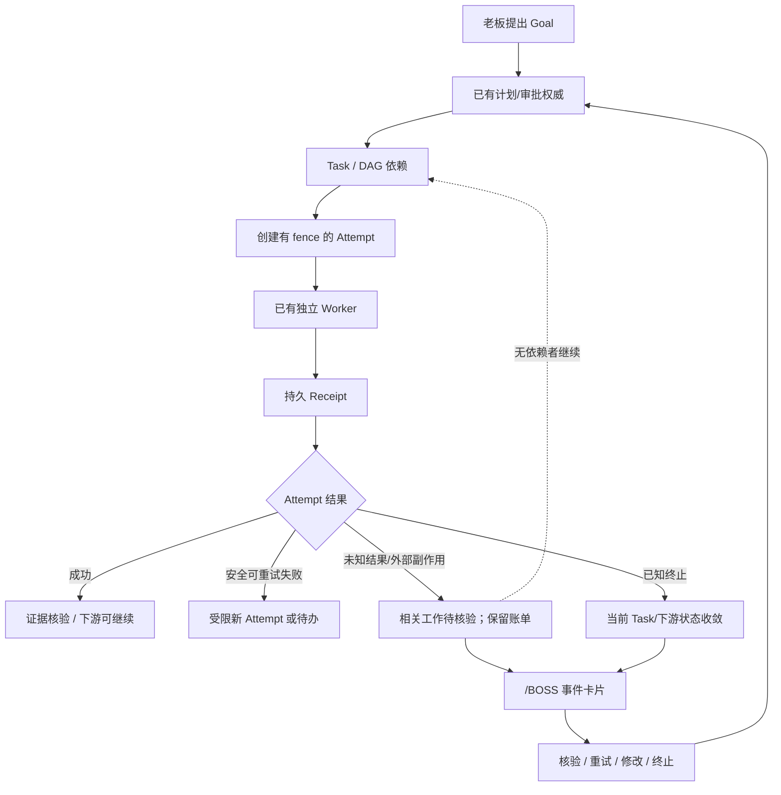

# EmergentInc / BOSS:/AFK — V35 事件化执行收敛与故障隔离执行 PLAN

> 版本：V35 · 2026-10-17  
> 执行方：本地 Codex（实施、测试、验证）；Owner 负责经营目标和不可逆决策  
> 产品入口：`/BOSS`（BOSS:/AFK · 甩手掌柜）  
> 基线：`lx00018310/EmergentInc` `main`，核查时提交 `8d9ed844c9e9d5e528f5d046ca979ebad8086d05`。**执行前必须重新读取本地 HEAD、工作区改动和最新代码，以实际文件为准；不要回退或覆盖用户已有工作。**  
> 关联文档：用户的《BOSS_INTERACTIVE_ATTENTION_CHANGE_SPEC.md》（2026-10-17）；仓库 `docs/architecture/BOSS_PAPERCLIP_REFACTOR_PLAN.md`、`BOSS_IMPLEMENTATION_STATUS.md`、`docs/guides/V34_RESET.md`。

## 0. 决策与一句话目标

**不再推倒重来，不再叠加新的 Agent 框架，不按代码行数强制删除 30%。**

以 V34 已完成的 Paperclip 式 **公司控制层 + 独立 Worker + Task/Attempt + 持久回执 + 费用账本** 为基线，实施 **“局部故障收敛、统一事项处理、谨慎减法”**。

> **一项工作失败，只影响该工作及其真正依赖者；其他工作继续。老板能在 `/BOSS` 的原事件卡片内选择重试、修改、终止或核验，服务端确认后该事项退出待办，不会再次成为死锁。**

成功不是“永不出错”，而是：**失败可归属、状态可收敛、操作可决定、费用可追查、独立工作可继续。**

### V35 明确不做

- 不接入 Temporal、LangGraph、Redis、Kafka、另一个 Harness；不迁移 PostgreSQL。
- 不重新引入旧的抽卡、会议、Pixel 可视化、复杂 Gene UI 和四导航。
- 不创建一套与 Goal/Task/Attempt 并行的业务状态机或第二个事实数据库。
- 不清空 V34/G0003 实例，不执行 V34 破坏性重置，不删除现有客户/付款/费用/产物/未知调用记录。
- 不为了凑“删除 30%”破坏调度、费用审计、幂等或安全约束。
- 不把“清空事件”实现为 SQL DELETE、不伪造费用 0、不伪造任务完成、不盲目重放外部写入。
- 不在 V35 扩建“视察公司”；只保留现有可追溯的检查入口。

## 1. 源码调查与当前问题（先验证事实）

### 已在 `8d9ed84` 核对的存在项

| 模块/文件 | 当前事实 | V35 要处理的问题 |
|---|---|---|
| `apps/server/src/services/company_execution_service.ts` | Attempt、fence、receipt inbox、outbox、账单状态已经存在 | 失败/终止/重试的权威边界；新 Attempt 必须不覆盖老 Attempt |
| `company_worker_adapter.ts` | 独立 Worker、私有日志与恢复已经存在 | 终止须证明旧执行者不再有写入权；未知外部副作用不得重播 |
| `company_goal_scheduler.ts` | 新公司任务调度路径已经存在 | 同一 Goal 的独立 DAG 分支在局部失败后能继续；状态不循环互锁 |
| `owner_goal_scheduler.ts` | 为新公司与旧运行保留入口；外层未捕获异常会阻断 `scheduler` | 明确可恢复的单事项失败与真正全局故障边界 |
| `owner_work_service.ts` | `start()` 中未捕获异常将记录 `schedulerError` 并停止轮询 | 防止一个坏任务使整个 Worker 调度器永久停止 |
| `owner_automation_gate.ts` | 公司手动 ON/OFF、预算及 admission 均在此 | “人工 OFF”和“局部阻塞”必须分离；只对真实全局条件阻塞公司 |
| `company_admission_service.ts` | 已有公司级阻塞记录 | 公司级阻塞要有确定的适用范围和解除条件，不能被普通单任务故障滥用 |
| `company_recovery_service.ts` | 已支持不确定执行放弃、费用与安全核验部分动作 | 统一卡片处理而不是另建一套清除状态的捷径 |
| `owner_goal_service.ts`、`owner_proposal_service.ts` | 目标修订、暂停/停止/重开、审批与验收已有规则 | 补齐安全的“修订/重新规划/继续”而不绕过权限 |
| `owner_overview_service.ts` | 已汇总审批、告警、目标与执行信息 | 输出基于真实关联的、可处理的事项；同一事故不占多个槽位 |
| `frontend/src/features/boss/bossAttention.ts` | critical/decision/milestone 排序，截取前三 | 按用户文档建立事实评分、稳定重排；不随 5 秒轮询乱跳 |
| `BossConsole.tsx`、`BossRecovery.tsx` | 主要审批、预算、恢复存在，但一些操作需要弹窗 | 真实事件卡内完成实际决策；完整处理后才消失 |

`docs/architecture/BOSS_IMPLEMENTATION_STATUS.md` 声称 G0003 已完成 16 项验收；这是**历史交付报告**，不代表新发现的所有边界都无缺陷。先复现 V35 指定的故障场景，不能用“731 项旧测试通过”代替新验收。

### 执行前基线检查

1. `git status --short`、`git log -1 --oneline`，记录未提交/已暂存文件；不得覆盖或擅自清空。
2. 阅读上述文件、`apps/server/src/app.ts`、`apps/server/src/routes/owner_routes.ts`、`packages/protocol/src/types/owner.ts`、`packages/protocol/src/types/company_execution.ts`、`frontend/tests/boss.test.tsx` 与现有服务端测试。
3. 梳理 `Goal → TaskNode → Dispatch → Task → Attempt → Worker → Receipt → Accounting` 的实际读写关系；标出唯一作者、派生状态、原子事务边界。
4. 特别检查：`owner_goal_scheduler.ts` 与 `owner_work_service.ts` 的 timer catch；`CompanyGoalScheduler.tick()` 中的逐任务异常隔离；`company_execution_service.ts` 失败是否过早把整个 Goal 设为 BLOCKED；`owner_automation_gate.ts` 的 `halt/isOn/scopeBlocked`；旧 Legacy adapter 可能造成的双重解释。
5. 写一页 **V35 状态权威与故障范围表**（放 `docs/architecture/V35_STATE_AUTHORITY.md`）。本表先提交到 Plan 的实施文档，再修改代码。若调查发现本 Plan 提议的能力已经可靠实现，**不重复实现**，只补测试和清理调用点。

## 2. 不可妥协的设计规则

### 2.1 只有四类职责，不创建新“总经理状态机”

1. **Goal / TaskPlan**：描述老板目标、任务依赖、验收条件与允许范围；由控制层管理。Goal 状态可作汇总投影，不再独立持有一次模型调用的锁。
2. **Task / Attempt / Receipt**：唯一执行事实。一个 Task 可有多个有序 Attempt，旧 Attempt 不可被新尝试覆写；凭 `revision + fence + idempotency key` 判断归属。
3. **Accounting / External effect**：独立保留费用预留、已结算账单、工具/外部副作用回执。不由 Task 成败隐式清账。
4. **AttentionItem（老板待处理事项）**：从上述权威事实计算出来的**可操作投影**，不是新增一套任务真相。处理命令最终路由到对应现有权威服务。

### 2.2 故障作用范围必须有明确规则

| 作用范围 | 典型情形 | 允许效果 |
|---|---|---|
| `ATTEMPT` | 模型断线、输出无效、单次 Worker 崩溃、局部工具失败 | 此 Attempt 收敛，相关 Task 可重试/待决；其他 Task 不受影响 |
| `TASK` / `TASK_BRANCH` | 当前执行失败、依赖输入缺失、结果未明 | 当前节点及真实下游依赖等待；同 Goal 其他独立分支继续 |
| `GOAL` | 目标授权过期、业务目标整体停止、目标级权限缺失 | 本目标停/等，其余目标可继续 |
| `COMPANY` | 老板手动 OFF、全公司预算不可用、账本完整性异常、确证的跨公司安全风险、维护切换、数据库不可安全读写 | 禁止公司新派工；保留所有事实；显示真正的全局原因 |

**网络异常、单任务 JSON 错误、单个未知模型费用、单个外部操作结果未知，原则上不得调用全局 `halt()`。**

仅在预算已不可满足最小授权调用、费用越权等真实全局风险时保留全局 admission。对“超出预留”必须判断是系统级预算安全问题还是单笔待核验，不允许随意降级安全保护。

### 2.3 “清空事件”必须定义为业务命令而不是删除事实

UI 对老板可以叫“终止此事 / 放弃此事”，服务器必须有以下区别：

- `RETRY`：证明原 Attempt 已终止或安全隔离后，**创建新的 Attempt**；复用可复用的已付费回执；不可直接把旧 `FAILED/BLOCKED` 改写成 `RUNNING`。
- `REVISE`：按老板修改要求更新 Goal/TaskPlan 的修订版本，旧审批绑定过期，依赖链重新校验；生成新任务而不是偷偷修改已授权命令。
- `SKIP / STOP_TASK`：仅终止这项工作，解除它不应持有的执行/调度占用；下游按依赖规则进入等待、跳过或重规划；**绝不把 skipped 当作 completed**。
- `STOP_GOAL`：停止当前目标的未派发工作；正在执行的必须受控中止；其他目标继续。
- `ACKNOWLEDGE_UNKNOWN`：停止继续等待“未知执行结果”，但未知账单和外部副作用证据继续存在，且不得自动重放。
- `SETTLE_CHARGE`：独立录入已核验的真实账单，校验回执、用量、金额与预留，不等于完成任务或批准重试。

对外不可逆操作（付款、公开发布、发送消息、写第三方系统）在 UNKNOWN 时，**没有有效核验/幂等保障就禁止自动重试**。纯内部、无外部副作用的失败操作才可按有上限规则自动尝试。

### 2.4 不增加无必要技术复杂度

- 使用现有 TypeScript + React + SQLite。能用现有表/事务/唯一约束实现，就不建新表。
- 只在确有缺失时添加最小的 `action_receipt` 或 `attention_decision` 关联记录；优先重用 `owner_goal_events`、`control_events`、已有幂等表。
- 不把每个 Event 变为一个单独微服务/进程，不使用通用 Event Sourcing 重写。
- 不增加自动编造建议和 AI 优先级打分；优先级来自确定性事实。

## 3. 最小状态契约（实现时与真实类型对齐）

### 3.1 Attempt：事实与费用分离

当前已有 `company_execution_attempts` 的 `state` 和 `accounting_state`，沿用它们。不强行重命名现有生产枚举；在映射层规范下述语义：

| 业务语义 | 已有/目标表现 | 不允许的错误 |
|---|---|---|
| 正在执行 | `DISPATCH_PENDING / RUNNING / SUSPENDED` | 进程早已退出而永久 RUNNING |
| 成功回执 | `COMPLETED` + 独立账单状态 | 仅有模型文本即宣称目标完成 |
| 已知失败 | `FAILED / BLOCKED / INTERRUPTED` + 原因 | 单失败使公司 OFF |
| 结果未知 | 阻塞/待核验 + 原回执和预留 | 未核验即重播，或计费自动归零 |
| 已终止/放弃 | 用现有终态、审查记录与明确原因表达；必要时补最小终态 | 直接 DELETE Attempt 或遮蔽 UNKNOWN |
| 费用未结 | `accounting_state=PENDING`，无论执行是否结束 | 费用等待强迫任务维持 RUNNING |

**终态收敛要求**：worker 退出、超时或人为终止后，在有足够事实时更新 Attempt → Task → 当前 DAG Node；同一事务或可重试的幂等收敛保证最终一致。若状态尚无法判断，则明确显示 `UNKNOWN/NEEDS_REVIEW`，**不能假装已释放仍可能活着的进程**。

### 3.2 事件是“可操作投影”，不是另一个日志队列

建议投影契约（复用已有 `BossOverview` / `OwnerInboxItem` / `OwnerAlert`，仅补缺失的字段）：

```ts
interface BossAttentionItem {
  id: string;                   // 稳定的待办 ID，不能只用展示文案
  kind: 'decision' | 'blocked_work' | 'unknown_result' |
        'accounting' | 'configuration' | 'acceptance' | 'safety';
  incidentId: string;           // 同一根因的稳定归并键
  goalId?: string;
  taskId?: string;
  attemptId?: string;
  proposalId?: string;
  permitId?: string;
  title: string;
  reasonCode: string;
  firstNeedsAttentionAt: number | null;
  deadlineAt?: number | null;   // 只用真实业务期限
  revision: number | string;    // 对应权威实体的真实版本或 hash
  allowedActions: string[];    // 服务端依据当前事实计算
  status: 'pending' | 'submitting' | 'needs_verification';
  impactGoalIds: string[];      // 不由日志数量替代
  // 评分可在服务端纯函数或既有前端投影纯函数计算，禁止两套相互矛盾的规则。
}
```

这只是**交互数据契约示意**；不要求新建与之同名的表或复制所有字段。每次动作由服务端**重新校验**允许动作，UI 传来的 `allowedActions` 不具有授权效力。

**事件清除规则**：只在权威数据证实该事项得到真正解决后从待办投影移除；部分恢复后还有未知费用，就保留“核验费用”子事项。事故聚合不会吞掉同一目标下的两个独立审批。

## 4. 三阶段实施（按顺序通过关卡，不准同时重写）

### P1 · 先让故障停在本地（本版最高优先级）

#### P1-1 编写失败范围契约与测试（先红后绿）

添加最少 8 个核心故障测试：

1. Task A 模型调用 `ECONNRESET` 并成 UNKNOWN，Task B 属于另一独立 Goal，预算充足：B 成功，Company `desiredMode` 不从 ON 变 OFF。
2. 同 Goal DAG：A 失败，B 不依赖 A，C 依赖 A：B 继续，C 等待；Goal 汇总不得把 B 锁死。
3. Worker 强杀：Attempt 不永久 RUNNING；核对进程身份、租约、fence 和持久回执后收敛。
4. 非法 JSON、计划解析失败：只影响当前命令或方案；不能创建半条已授权流程，不能关闭 scheduler。
5. 调度某一事项时 DB/业务校验抛可归属异常：记录 `taskId/attemptId` 和原因，继续检查其他事项；若是数据库损坏或事务原子性无法保证，则应全局阻断并保留诊断。
6. 未知外部写入：只冻结相关操作及依赖；不能自动重播；无关纯内部工作继续。
7. 费用缺回执但模型工作已终止：Task/Attempt 不永久 RUNNING，预留继续存在；追加预算不会自动假结算。
8. 人工 OFF / 全局账本越权 / 发布维护：必须继续阻止新派工；不准为“避免互锁”绕开安全检查。

用真实 `pnpm` 测试运行验证；至少一个场景跑实际 Windows worker 进程或等价本机子进程，不只 mock。

#### P1-2 修改故障边界

优先文件：

- `apps/server/src/services/owner_work_service.ts`
- `apps/server/src/services/owner_goal_scheduler.ts`
- `apps/server/src/services/company_goal_scheduler.ts`
- `apps/server/src/services/company_execution_service.ts`
- 必要时 `company_worker_adapter.ts`、`company_admission_service.ts`、`owner_automation_gate.ts`

执行要求：

1. **将调度循环拆为“获取可执行项 → 单项事务/派发 → 错误分类与收敛 → 下一项”**。把单项异常捕获限定在 Task/Dispatch/Attempt 范围；每个失败写出稳定实体 ID、具体阶段、原因和恢复提示。
2. **不要包一层宽泛 `catch {}` 然后悄悄跳过。** 必须保证日志/事件落地；仅已分类、可隔离、可审计的错误才局部失败。数据库不可写、严重不一致、公司账本越权等仍是全局阻塞。
3. 不可归属的 scheduler 内部崩溃：保持**可诊断的全局保护**，同时提供明确的恢复动作/健康状态；不得使用进程反复无界自动重启掩盖损坏。归属明确的命令异常不得触发全局 scheduler `closed=true`。
4. 消除“旧 Attempt 已终态但 Task/Goal 永久 RUNNING”的状态传播遗漏；使用回执幂等及原子条件更新，而不是任意 `UPDATE ... RUNNING` 强制改写。
5. 收缩 `Goal` 在单 Attempt 失败时直接转 `BLOCKED` 的位置；如同 Goal 仍有可调度的独立 DAG 节点，应反映可继续工作；若下游依赖失败步骤则等待，不标记为完成。
6. Worker 已退出但存在未知副作用时，允许释放**调度资源/工作占用**（在确认执行权已失效以后），不解除对应账单和外部核验义务。
7. 明确两种等待：`BLOCKED_ON_DEPENDENCY`（不自动派工，等上游/修订）与 `NEEDS_OWNER_DECISION`（待老板），不要由 `RUNNING` 兜底表达等待。
8. 允许被证明未发送的纯只读调用有限重试（建议保留或使用已有 `notSentRetries` 上限）；对已发出但结果不明的调用禁止自动新 Attempt。
9. 任何恢复不得隐式将 `desiredMode=OFF` 改为 ON，也不得清空 `company_admission_blocks` 的真实 safety 记录。

#### P1 验收闸门

- A 失败、B 继续、C 等上游，均有可追踪回执；公司 ON 未被局部错误篡改。
- Task/Attempt/Goal 投影一致，执行已结束不再出现无限 RUNNING。
- UNKNOWN 账单与预留不减少；未知外部写入不重放。
- 对账、终止、强杀后重启均可重复查询，状态稳定且无重复执行。
- P1 失败则**不进入 P2/P3**。

### P2 · 统一事件动作（给老板一个“处理此事”的按钮，而不是万能删库）

#### P2-1 复用现有命令，补最少缺口

建议在现有 `owner_routes.ts` / `owner_goal_service.ts` / `company_recovery_service.ts` 上构建**薄命令路由**，不另建新的工作流框架。

现有可复用能力：`owner/goals/:id/actions`、`owner/goals/:id` PATCH、`owner/proposals/:id/decision`、`owner/requests/:id/decision`、`owner/execution-recovery/:id/abandon`、`owner/automation/calls/:id/reconcile`、预算与付款配置接口等。

新增一个统一前端**事件动作适配层**（可沿用这些既有端点）；只有确有必要时再引入：

`POST /api/boss/attention/:id/actions`

示意请求：

```json
{
  "action": "STOP_TASK",
  "target": {"goalId": "goal_...", "taskId": "task_...", "attemptId": "attempt_..."},
  "expectedRevision": 7,
  "idempotencyKey": "stable-on-retry-key",
  "reason": "本次工作不再需要"
}
```

后端必须从服务器计算关联实体和允许动作，不信任浏览器传入的任意 `target`；服务端执行已有领域命令并返回**权威新状态**，不能让新端点直接修改多个旧表作为捷径。

**建议只增两个确实缺少的业务能力**：

- `STOP_TASK / SKIP_STEP`：前提为仍可安全结束；终止当前 Attempt 与相关派工、释放可释放的资源，调整依赖 DAG；若存在可能仍在执行的副作用，则先进入待核验而不宣称终止成功。
- `RETRY_OR_REVISE`：区分原样安全重试和目标内容修订；修订必须重新经过原有授权/审批；重试创建新 Attempt 并受限额、版本和效果确认保护。

如现有 `goal.action` 已满足某动作，直接复用，不重复增加。

#### P2-2 操作原子性与恢复语义

- 统一绑定事件 `id + 实体 revision/hash + idempotencyKey`；请求不明时重试**原请求及原键**。
- 重试事件的草稿和请求状态按 `instanceId + attentionItemId` 隔离，切换中英、折叠/展开、轮询后不丢失。
- 外部接口无法 exactly-once 时，必须依赖业务幂等键/读取远端结果或人工核验；禁止凭“重试一次”许诺无副作用。
- 完成一个审批如果衍生账单未结事项，**仅移除审批子项**；保留结算子项。
- “清空/终止事件”之后仍有待核验费用时，卡片应**转换为下一步核验事项**，不能统一消失。
- 一切“拒绝”“终止”不得影响其他无关的 Goal；不能因为拒绝招聘就关闭全公司。

#### P2-3 决策矩阵（实施时变成测试表）

| 事项种类 | 主操作 | 实际推进 | 不能做 |
|---|---|---|---|
| 计划审批 | 批准/拒绝/提出修改 | 原 proposal 修订绑定或创建新版本 | 未审核即发起高风险外部写入 |
| 招聘等待 | 批准/拒绝/补充条件 | 对应招聘请求 + 被依赖的节点 | 无关目标停机 |
| 成果验收 | 验收/退回修改 | 核验已存在产物及 hash，或修订要求 | 空口验收当作实际产物 |
| 已知执行失败 | 安全重试/跳过/停止目标 | 当前 Task 和依赖链 | 重播外部未知副作用 |
| 未知模型调用 | 核对费用/放弃执行结果/停止目标 | 分离执行审查和账单核对 | 自动填写 0 元、释放真实预留 |
| 预算不足 | 追加公司共享预算 | 仅提升准入条件 | 自动打开人工 OFF |
| 收款未配置 | 设置公开只收款地址 | 检查链和地址，启用支付入口 | 收集私钥/伪造收款 |
| 模型配置缺失 | 指明缺失与受控配置途径 | 配置实际生效后才解除卡片 | 浏览器保存模型 API 密钥 |

#### P2 验收闸门

- 至少跑通“失败→安全终止→原待办消失→独立 Task 继续”和“失败→核验→新 Attempt→完成”两个真实闭环。
- 每个动作均拒绝过期 revision/hash、重复提交与越权 action。
- 决策中断、HTTP 超时、浏览器刷新可凭原幂等键确认最终状态，不能出现双批准/双扣费/双派工。
- 单一工作被终止不删除原始调用、账单、产物和订单记录。

### P3 · 最后做 BOSS 极简卡片和架构减法

#### P3-1 事件评分与排序：依用户文档执行，做一处明确修正

参考用户《BOSS_INTERACTIVE_ATTENTION_CHANGE_SPEC.md》原始设计：

`Priority (0–100) = B 阻塞(0/15/25/35) + R 风险(0/8/15/25) + U 时效(0/4/10/16/20) + I 影响(0/3/6/10/15) + W 等待(0…5)`。

落实规则：

- 评分只用**经过验证的服务端事实**，不能让模型自称“很紧急”加分；缺时间不默认为 1970，CNY/USDT 不混算；影响范围统计业务 ID 而不是日志条数。
- 每 **5 秒**刷新事实；正常每 **5 分钟**重排卡片。编辑和未决提交时冻结当前卡的位置，不能挤掉输入内容。
- **重要修正**：新出现的真实全局安全事故/临近截止关键决策，可立即插入前三并给出清晰提示；普通新消息仍按五分钟稳定重排。不得把严重事故隐藏五分钟。
- 卡片处理成功后立即刷新、补位；未解决的其它事项留在“其他待处理（N）”。总是**最多三张**。
- 同一事故按稳定 `incidentId` 归并，但同一 Goal 的不同 Proposal/批准必须保留各自决策操作；优先级不等于概率或目标完成率。
- **只展示老板确实需要动作的事项**。已完成且无需老板介入的普通 milestone 记录进入现有“视察公司”详情，不占这三个处理席位。交付待验收仍占。

#### P3-2 单卡闭环，尽量不要跳大弹窗

修改建议：

- `frontend/src/features/boss/bossAttention.ts` — 纯函数生成候选、合并根因、排序和稳定刷新；不额外持久化业务事实。
- `BossConsole.tsx` — 保留三个指标、最多三张卡、老板对话输入、公司开关和“视察公司”入口。
- 新建**一个轻量** `BossAttentionCard.tsx`（若能直接抽自现有 `AttentionMessage` 则迁移），依据 `allowedActions` 显示对应表单。
- `BossRecovery.tsx` — 提取可复用单条核验表单，供卡片内直接使用；保留集中查看能力但不再要求先跳一个大窗口才能解决当前事件。
- `BossBudget.tsx`、`BossPayment.tsx` — 复用现有控件，避免再造预算/收款状态。
- `frontend/src/i18n/boss.ts`、现有 `en`/`zh-CN` 字典 — 中英完整同步。

每个卡片包含：**具体事件标题 / 发生原因 / 当前影响 / 明确操作 / 操作反馈**；额外原始回执和历史可折叠查看。服务端没有能力执行的按钮**不允许放在前端伪装可用**。

“视察公司”本版不扩建；保留现有只读诊断入口，用于查询目标、Task、Attempt 和实际产物。维护现有 `/BOSS` 入口与 `/OWNER` 兼容地址，不扩建四导航。

#### P3-3 以“减少第二套实现”为目标删代码

先做调用链与测试覆盖检查，再实际删除/合并：

1. 已被 Company Worker 完全取代、且无正在运行的旧任务依赖的旧 dispatch、重复状态映射与重复恢复分支。
2. 重复的 OWNER 和 BOSS 审批展示逻辑、分别维护的费用/执行状态判断。
3. 没有调用者的 UI 组件、重复事件合成器、过时 README 截图和错误说明。

**不要强制删除 30% 文件或表**。把减法写成可量化检查：

- 关键经营执行路径由一个调度权威控制；不得出现两个 scheduler 抢同一 Task。
- `Goal/Task/Attempt` 状态归属写入点更少，重复 `state===...` 跨模块判断尽量集中到纯函数/策略表。
- 老板日常操作入口继续维持“3 指标 + ≤3 待办 + 对话 + 开关”。
- 删除清单逐项记录“删除代码文件/调用点、原用途、替代实现、证据与测试”。**安全或历史数据兼容约束未满足则暂不删除**。

#### P3 验收闸门

- 三条卡片均可直接完成允许的动作，提交结果以服务器权威状态为准；无功能的按钮不出现。
- 5 秒事实更新、5 分钟常规排序、紧急事故立即上屏、编辑不丢草稿、卡片处理后自动补位。
- 中文/英文、桌面/390×844 移动端正常；无伪造数字、`NaN`、无依据的“已成功”。
- 删除的每条旧路径都有替代和回归测试；旧数据和升级能力未受损。

## 5. 更精确的实现细则

### 5.1 最小端到端流程



注：箭头“老板决定 → P”表示**经过已有领域服务与权限校验**，不是直接修改 Proposal 表。若一项工作未获批准，不能因事件重试绕过批准。

### 5.2 事件生命周期

`FACT_OBSERVED → ATTENTION_PENDING → OWNER_ACTION_REQUESTED → DOMAIN_CONFIRMED → RESOLVED/REPLACED`。

这是**UI 投影生命周期**，不是新增第二套持久业务状态机。未知请求保持 `REQUEST_RESULT_UNKNOWN`，其草稿/幂等键留存；重新查询或重试相同请求直到确认，不能直接归档。

重要：
- 一个事故可包含执行待核验、费用待核验等多个子义务。
- 处理其中一个子义务，不得误删其它子义务。
- 如果“清空”的意思仅仅是“我暂时不想看”，可考虑界面折叠，但不得消除必须的人审/账务待办；V35 默认不提供危险的“强制忽略所有”操作。

### 5.3 状态归属图应执行检查

| 真相 | 唯一写入者 | 其它模块只能做什么 |
|---|---|---|
| Goal/审批 | Goal/Proposal Domain Service | Scheduler 查询、投影读取 |
| Task/Attempt/Fence | Company execution controller | Worker 上报事件；不能直接改数据库 |
| 实际用量/预留 | Budget/Model ledger | Task/Goal 引用费用状态，不虚改金额 |
| 外部结果/工具副作用 | 有幂等回执的受控工具适配器 | 调度器看已核验回执，不猜测 |
| 首页待办/优先级 | 只读 projection | 由事实导出，不能反写业务数据库 |

如现有代码有受控多写入点，优先沿用已有事务 API 收敛，避免为了“形式唯一”引入新 service 层级。

## 6. 必须跑通的故障矩阵（最终验收）

| # | 场景 | 预期结果 |
|---:|---|---|
| 1 | A `ECONNRESET` + B 独立运行 | A 待审；B 成功；公司意图 ON 不变 |
| 2 | 同 Goal DAG：A 失败、B 独立、C 依赖 A | B 继续；C 等待/改计划；Goal 不死锁 |
| 3 | Worker 强杀/进程失联 | 不凭租约盲开双 Worker；安全收敛与恢复 |
| 4 | Controller/API 重启 | 已收到的 paid response/工具回执复用，不双收费/双提交 |
| 5 | 错误 JSON/解析异常 | 局部失败可视、可处理，调度循环继续 |
| 6 | Task/Goal 手动停止 | 只影响关联工作；手动 OFF 语义不变 |
| 7 | 外部写入 UNKNOWN | 只隔离关联执行，禁止盲重放；保留核验 |
| 8 | 模型费用 UNKNOWN | 保留预留；其它预算可用工作继续；不自动结算零元 |
| 9 | 已支付订单交付阻塞 | 订单仍可追查，正确优先展示，不能跳过履约义务 |
| 10 | 同一审批双击/网络断线 | 原幂等键重试，准确一次业务生效 |
| 11 | 旧事件版本冲突 | 返回冲突与最新事实，保留用户草稿、不错误提交 |
| 12 | 恢复安全限制/预算不足 | 不能假装局部解决；全局保护仍有效 |
| 13 | 老板处理一张待办后 | 一张消失或转下一子事项，其它事件正确补位 |
| 14 | 5 秒事实刷新与 5 分钟排序 | 普通不乱跳，紧急立即上屏，编辑不丢失 |
| 15 | 非法旧回执/乱序回执 | fence/revision/sequence 防覆盖、无重复作用 |
| 16 | 双语和 390×844 | 所有动作和错误可用，用户不用跳其它页面 |
| 17 | `/BOSS` 及旧 `/OWNER` 兼容 | 新主页正常，旧书签安全导向，不重新出现四导航 |
| 18 | 软件发布/回滚 | 仅兼容版本回滚，预算、订单、费用和核验数据不丢失 |

至少做 **一个完整的本地端到端“坏任务 A + 好任务 B + 老板处理 A + 后续继续”演示**。演示记录包括 Goal/Task/Attempt ID、事件 ID、关键状态和回执摘要（敏感令牌不得入日志）。

## 7. 执行顺序、交付物和操作规范

### 本地 Codex 执行次序

1. **诊断，不先写大规模重构代码**：绘出状态权威和实际调用链、确认本地 HEAD 与当前 G0003/V34 兼容边界；把问题与已有安全机制分开。
2. **P1 先测试后修故障隔离**；测试通过才进入下一阶段。
3. **P2 实现统一事项动作**；有现成服务就复用，缺口才补最小接口。
4. **P3 改 `/BOSS` 页面和评分排序**；清除确定无依赖的重复实现。
5. 每阶段执行 typecheck、相关测试，最后全量测试、前端构建及受控发布兼容检查；失败先修，不以仅 lint 通过宣称完成。
6. 对实际线上/本地经营实例使用无付费模型调用的单元/集成测试优先；必须实测付费/外部操作时，仅用隔离测试实例、显式有限额、模拟回执或用户明确批准。**不要自动发布商品、发真实消息、转账或发起未知成本的模型调用。**
7. 不擅自 `git reset --hard`、清空 workspace、删除生产 DB、`git push`；保留用户未提交与暂存改动。不需要另建整个产品架构。

### 实测命令（按本地环境调整，不写死不存在的脚本）

```bash
pnpm typecheck
pnpm test
pnpm --filter emergentinc-frontend build
```

Windows 本地可用 `pnpm.cmd`。为避免全量测试过慢，先运行单文件测试；最终按项目既有脚本执行完整回归，记录失败/跳过的原因。验证源码版本与运行部署版本一致，注意现有 8766 发布及 worker protocol 兼容性。

### 最终交付文件

- **新增** `docs/architecture/V35_STATE_AUTHORITY.md`：真实状态读写关系、错误作用范围与已解决的交叉锁。
- **新增** `docs/architecture/V35_EVENT_ACTION_CONTRACT.md`：事件投影、可用动作、幂等/权限/安全边界、故障矩阵。
- **新增** `docs/architecture/V35_DELETION_AUDIT.md`：本轮确认删除的重复代码及替代路径；未删项标明原因。
- **新增/更新** 调度、执行、恢复、BOSS 前端测试及最小端到端验证日志。
- **更新** `README.md`（英文主）、`README_CN.md`（中文）、老板使用文档中真正变化的行为；不夸大“永远不会失败”。

### Codex 最终回报必须包含（禁止只报“已完成”）

1. 当前 commit 和修改的文件清单。
2. P1/P2/P3 各自的验收结果，失败与未完成内容明确列出。
3. A 失败、B 继续的证据，Goal/Task/Attempt 与财务状态前后对照。
4. “清空此事件”到底使哪些业务状态变化、哪些事实明确保留。
5. 删除了什么重复实现，为什么安全；没有删除什么、原因是什么。
6. typecheck、全量/单项测试、构建、双语与移动端、部署/回滚检查的结果。
7. 尚存的无法从代码保证的外部网络与供应商风险。

## 8. 完成定义（Definition of Done）

**全部成立才称 V35 完成：**

- [ ] 一个局部 Task/Attempt 异常不会关闭公司级调度器；另一个无依赖任务真正继续执行。
- [ ] 同 Goal 独立 DAG 分支可继续；相关依赖等待，不发生循环互锁。
- [ ] 任意已结束 Attempt 都有明确终态或待核验原因，不出现无限 RUNNING 的假状态。
- [ ] 老板在 `/BOSS` 原卡片内能够处理真实事件：核验、批准/拒绝、必要时安全重试/终止/修改。
- [ ] 处理成功与事件消失均来自权威事实；费用 UNKNOWN、外部 UNKNOWN 不随事件终止而抹去。
- [ ] 三指标、最多三待办、对话、运行开关保持极简；事件正常每五分钟重排，重大风险即时显示。
- [ ] 操作幂等、revision/hash、fence、租约、权限与审计仍有效。
- [ ] 全公司停机只用于明确的人工/安全/账本/维护边界；故障原因可追查，不隐式恢复手动 OFF。
- [ ] 删除的是重复状态判断与旧双轨实现；没有另加一套框架或重复数据库。
- [ ] 中英双语、移动布局、真实子进程、回滚兼容回归通过。

**V35 的唯一评价标准：老板遇到坏事可以放弃这件事，而公司依然继续做其它好事。**
