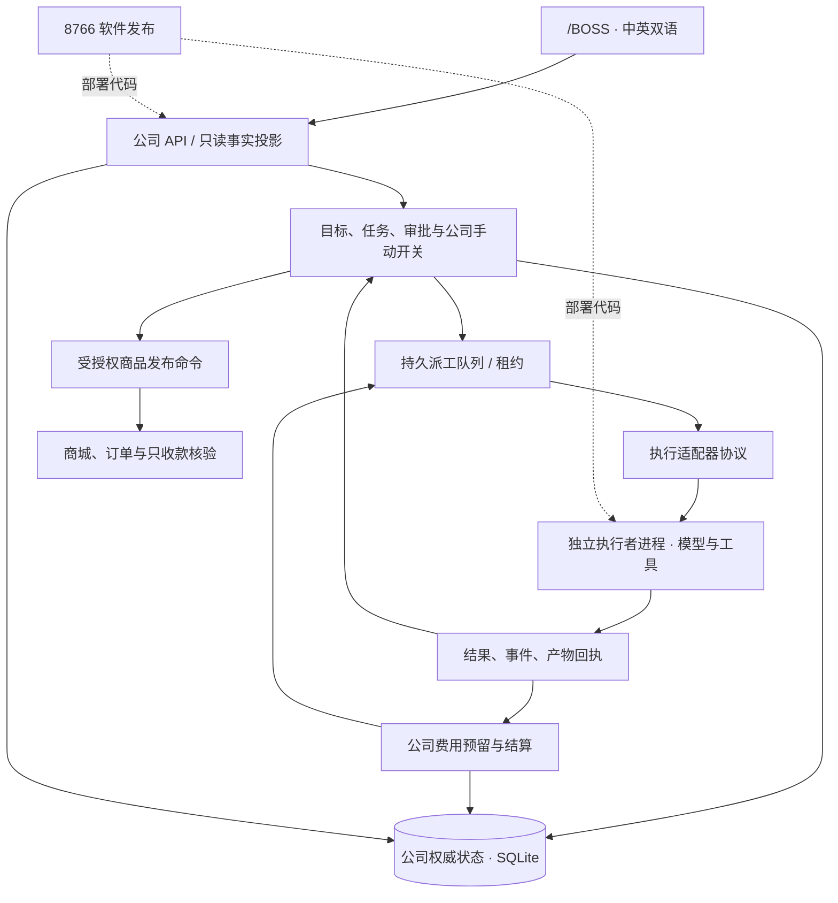

# BOSS 架构移植与改造方案

日期：2026-10-17。本文保留最初诊断和设计基线；后续实现、非破坏性迁移及 G0003 生产交付已完成，当前证据见 [实施状态](BOSS_IMPLEMENTATION_STATUS.md)。下文事故表及研究边界记录的是改造前状态。

This document preserves the initial diagnosis and design baseline. Implementation, non-destructive migration and G0003 production delivery are complete; see [implementation status](BOSS_IMPLEMENTATION_STATUS.md). The incident table and research boundary below describe the pre-migration state.

## 结论

选择 **Paperclip（paperclipai/paperclip）** 作为架构基线。它与本项目同属“老板管理目标、AI 执行工作、预算约束、审批介入”的公司控制系统，匹配度高于通用 Agent 框架或编程助手。

复制的是完整参考源码和可追溯的职责边界，不把第三方实现直接覆盖到现有经营实例。Paperclip 当前主调度文件本身有 4,147 行；照搬所有实现也会带入数据库、部署和产品复杂度。推荐移植它的控制层、执行适配器、独立运行记录和费用记录的边界，先保留当前 Windows、TypeScript、SQLite、`/BOSS`、商城和收款协议。

目标不是保证网络永远不失败，而是保证网络失败不会通过错误的状态传播使整家公司失去可用性。

## 一、这次卡住的事实

证据快照：`owner_private/architecture-research/failure-evidence.json`。只读查询正式数据库取得，未填写任何供应商账单或恢复决定。

| 层级 | 当前事实 |
|---|---|
| 真实运行 | `run_1792167892441_2nuu`，首次调用约 5.121 秒后停止 |
| 错误 | `ECONNRESET`；错误摘要为 `Model request outcome unknown (ECONNRESET, dispatch)` |
| 模型回执 | 没有响应正文、Token 或费用，`CALL_OUTCOME_UNKNOWN` |
| 公司调用记录 | `UNKNOWN`，费用预留 516 微元，即 0.000516 CNY |
| 公司 | `OFF / OWNER_OUTCOME_REVIEW_REQUIRED` |
| Run | `STOPPED / CALL_OUTCOME_UNKNOWN` |
| Task | 仍为 `RUNNING` |
| Goal | 仍为 `RUNNING`，交付证据 0 |
| 首页 | 显示恢复告警，但“受影响目标”为 0；同一个故障又产生公司层告警 |

这不是预算耗尽，也不是凭截图推测的“模型还在思考”。直接诱因是连接重置。连接重置由供应商、网络、中间代理或本机哪一段引发，现有回执不能进一步证明。

### 状态传播中的问题

1. `owner_automation_gate.ts` 的 `provider()` 把非 `InfrastructureFailureError` 记为 UNKNOWN，并调用全局 `halt()`；`halt()` 将公司写为 OFF 并请求所有 World 暂停。
2. 同一文件的 `hasUnknown()` 是全局判断；任何 World 的未决执行也能使全局 `isOn()` 返回 false。
3. `world_runtime_manager.ts` 把所有运行的恢复状态汇总回同一个全局 gate，扩大故障范围。
4. `run_service.ts` 为恢复保留 checkpoint；`owner_work_service.ts` 在 `resume_pending` 分支下并未覆盖全部阻塞原因，这次任务因此仍为 RUNNING。
5. `owner_goal_scheduler.ts` 看到 Task 仍是 RUNNING 就继续等待，Goal 也没有收敛为阻塞状态。
6. `bossAttention.ts` 只统计状态为 BLOCKED/FAILED 的目标，因此受影响指标为 0。

这些是同一次事故沿多个权威状态传播后的结果。不能通过自动填 0 费用、清除 UNKNOWN 或强制 ON 来修复。

现有 `owner_global_automation.test.ts` 还把“未知账单后全局停止并拒绝重启”作为正确行为。上次测试证明了这些保护会执行，没有证明保护范围符合甩手掌柜产品的可用性要求。下一轮必须先修改验收契约，再改实现。

## 二、开源项目选择

| 项目 | 与本项目的关系 | 决定 |
|---|---|---|
| [Paperclip](https://github.com/paperclipai/paperclip) | 公司、目标、任务、Agent、审批、预算、运行记录；Node.js/TypeScript/React | 唯一主参考 |
| [MetaGPT](https://github.com/FoundationAgents/MetaGPT) | AI 软件公司和角色协作，侧重多角色完成软件工作 | 不作为公司运营控制层基线 |
| [OpenHands](https://github.com/OpenHands/OpenHands) | 软件开发 Agent 与执行环境 | 可研究执行器，但不承担整个公司模型 |
| [LangGraph](https://docs.langchain.com/oss/javascript/langgraph/persistence) | 持久化工作流、checkpoint、人工中断 | 解决执行图问题；不自带本项目的公司业务模型，本轮不叠加另一套框架 |

### 固定参考版本

- 仓库：`https://github.com/paperclipai/paperclip`
- Commit：`647116dd4bf712bda3fb75f259ee684b23bf8bb8`
- 本地：`owner_private/architecture-research/paperclip/`
- 许可证：MIT；复制的源码保留了原始 LICENSE 和版权说明。
- 已完整检出此 commit 的源码；没有安装依赖、运行第三方代码或验证其 Windows 部署。

### 真正要移植的部分

| 参考源码（均为上述固定版本） | 取用的设计 |
|---|---|
| `doc/GOAL.md`、`docs/start/architecture.md` | 公司控制层与执行适配器分开；UI 通过 API 访问控制层 |
| `packages/adapter-utils/src/types.ts` | 统一执行结果：错误类型、可恢复证据、用量、费用来源、供应商请求标识 |
| `packages/db/src/schema/heartbeat_runs.ts` | 一次执行有独立 run；执行状态与 `costAccountingPending` 分开 |
| `packages/db/src/schema/issues.ts` | 业务任务与一次执行区分；任务 checkout、执行锁与版本可追溯 |
| `server/src/services/heartbeat/run-lifecycle.ts` | 终态转换、并发条件更新、租约释放前的状态收敛 |
| `server/src/services/heartbeat/queue.ts`、`recovery.ts` | 持久队列、执行归属、失联检测及恢复证据 |
| `server/src/services/budget-reservations.ts` | 派发前预留；未知费用不被清空；未完成预留参与后续准入 |

这里的“借鉴”不意味着照抄其 PostgreSQL/Drizzle SQL、美元费用单位、每月/每 Agent 预算或所有多公司功能。本项目继续使用已授权的公司共享 CNY 金额预算，不引回已删除的个人 Token 额度。

## 三、目标架构

### 六条必须成立的边界

1. **公司手动开关只表达老板意图。** 网络异常不得冒充老板修改 OFF。预算不足、安全事故或明确维护可以阻止新派工，但必须有单独原因和作用范围。
2. **故障先归属 Attempt，再归属任务。** 一名执行者失败不会调用“暂停所有执行者”。依赖这个任务的后续步骤等待；无依赖的工作按剩余预算继续准入。
3. **执行状态与费用状态分别记录。** `failed + accounting_pending` 是合法组合。未知金额仍保留预留；有足够未占用额度的其他工作不因“存在任意未知账单”而全局禁用。
4. **业务状态只有一个权威写入点。** 控制层维护 Task/Attempt；执行者报告事实，不直接修改公司库里的目标、预算、审批或商品表。执行者私有 journal 是回执来源，不是另一套业务状态权威。
5. **商城、付款与软件发布各自隔离。** 收款 RPC 出错只影响相关订单或上架条件。8766 控制代码版本，不能成为每次业务派工必须跨越的状态机。
6. **首页来自同一份服务端投影。** 投影携带 goalId/taskId/runId/attemptId 和版本；同一次事故显示一次，受影响目标从关联关系计算，不再只根据目标的历史状态字符串猜测。

## 四、当前代码怎么改

| 当前模块 | 改造动作 | 完成条件 |
|---|---|---|
| `owner_automation_gate.ts` | 拆出公司控制、执行准入、费用账本；移除模型适配器对全局 `halt()` 的直接调用 | 普通网络失败不改写老板的运行意图 |
| `owner_goal_scheduler.ts` | 保留 DAG 到期与依赖判断；把派工变成持久命令，把结果观察交给独立转换服务 | scheduler 异常归属具体命令/任务，不通过总 catch 停全公司 |
| `owner_work_service.ts` | 将规划、执行者登记、派发、执行观察拆为单向调用；统一所有恢复终态 | Run 终止后 Task 不会长期保持 RUNNING |
| `world_runtime_manager.ts` | 收缩为过渡执行适配器；从公司控制层移走 World/Pixel/CoreStore/Current 身份细节 | 控制层只认识执行器协议，不直接扫描 World 的 SQLite 表判断全公司能否运行 |
| `run_service.ts`、`packages/runtime` | 逐步包装为独立执行者进程；返回持久回执和 checkpoint | Web API 重启不会丢失已产出的结果，也不会重放未知副作用 |
| `owner_company_budget.ts` | 保留 CNY 整数金额与共享预算；按 Attempt 关联预留、实际用量和费用核验 | 不清空 UNKNOWN；账单缺失与执行阻塞分开 |
| `owner_overview_service.ts`、`bossAttention.ts` | 服务端生成带关联 ID 的事故与影响投影；前端主要负责呈现 | 本次情况显示 1 个受影响目标，单故障不重复成两条事故 |
| 商品/支付服务 | 继续通过明确审批和幂等命令执行；保持独立权限 | 模型不能直接写商品/支付表，RPC 失败不拖停调研工作 |
| 发布/回滚服务 | 保留独立受控发布，明确代码版本与业务状态的兼容边界 | 升级保留账本/订单/回执，不靠经营数据回滚恢复代码 |

## 五、最小协议和失败处理

持久实体至少包括 Goal、Task、Attempt、Approval、BudgetReservation、UsageReceipt、Artifact、ExecutionEvent、DispatchOutbox、ReceiptInbox。可在同一公司 SQLite 数据库内实现，不需要立刻增加 Redis、Kafka、Temporal 或多个后端服务。

派工事务：检查审批和预算 → 原子领取 Task/创建 Attempt → 预留额度 → 写派工 outbox → 提交。外部进程启动在事务外完成；重复领取受唯一键、租约和 fencing token 限制。

结果事务：按事件 ID 去重 → 记录回执与产物引用 → 转换 Attempt/Task → 写后续工作事件 → 提交。费用有完整回执时结算；缺失时保留预留并记录 accounting pending。

| 情况 | 目标行为 |
|---|---|
| 已证明未发送的连接失败 | 受上限约束的退避重试；不创建假账单 |
| 已发出、只生成文本的模型请求断线 | 本 Attempt 记录结果与费用待核实，保留预留；其他任务仍按可用额度准入。是否自动发起新 Attempt 属于明确的预算/重试策略，不能悄悄开启 |
| 外部写操作结果未知 | 阻塞相关操作和依赖任务；没有幂等或核验凭证时不得重放 |
| JSON/计划字段错误 | 规划或当前执行失败，返回具体诊断；不产生半个已授权任务，不停全公司 |
| 费用结算服务暂不可用 | 记录 accounting pending；不伪造 0，不把已完成交付改成仍在运行 |
| 老板手动暂停 | 全局阻止新派工；自动恢复路径不能改写这个决定 |

不承诺任意外部系统的 exactly-once。对支持幂等的接口使用业务操作键；对不支持的接口保留不确定结果并核验。预留约束的是系统准入，不能保证供应商永远不超报/超收费用。

## 六、实施顺序

### 第 1 步：先建立故障契约

把本次事故做成固定回归样例。确认哪些错误只阻塞 Attempt/Task，哪些情况可以阻止公司派工。先写验收矩阵，不再以通过测试的总数量作为可靠性证明。

### 第 2 步：完成一个最小纵向闭环

用“保存一个内部文件”的目标，实现统一 Attempt、独立 worker、幂等回执、费用待结算和只读投影。现有执行内核暂时仅通过 adapter 接入；旧 scheduler 与新 scheduler 不得同时领取同一业务任务。

### 第 3 步：迁移权威状态

从现有 Goal/Task/Run/Permit/Artifact 建立显式映射；检查所有主外键、未知调用、预留、审批 hash、订单私有 token 和回执去重键。迁移要有可恢复快照、版本标记和核对结果；不得清零或把旧 UNKNOWN 填成已结算。

### 第 4 步：切换控制层并移除旧入口

达到验收标准后，通过现有受控发布切换唯一调度权威。将 World/Pixel 控制细节从公司业务路径移除；兼容代码只在执行 adapter 内保留，避免“新框架套旧中枢”长期共存。

### 第 5 步：接入商业执行并验证真实边界

先接商品草稿与受审批的上架，再接订单与收款回执。每个有外部副作用的步骤单独核验幂等、回执和故障隔离，不把文本生成的成功当成付款或营收成功。

## 七、验收标准

1. 注入本次 `ECONNRESET`，受影响 Attempt 有明确终态/待核实状态，Task/Goal 和首页一致；不再出现 STOPPED 与无限 RUNNING 并存。
2. 一个任务断线时，另一项无依赖、预算足够的任务能继续执行；老板手动 ON 的意图不被改成 OFF。
3. 旧未知调用的 516 微元预留保留；新准入扣除所有已知费用与未决预留，不靠清账恢复运行。
4. Web/API 重启后，已落盘的模型响应和工具回执直接复用，不新增同一步收费调用。
5. worker 被杀后，租约超时、进程身份检查和 checkpoint 恢复有确定结果；无法确认退出的旧 worker 不能被并发重放。
6. 两个调度事件竞争同一 Task，只有一个 Attempt 获得执行权。
7. 回执重复投递或乱序到达，不重复扣费、结案或上架；版本不匹配的回执不覆盖新任务。
8. 模型输出多字段、无效 JSON、依赖环或无授权定时，不产生已授权执行，也不触发公司全局停机。
9. 外部发布/付款结果未知时不自动重放；相关不确定性不会禁止查看公司、调整其他任务或执行独立只读工作。
10. 费用回执晚到时可独立补结算；交付状态和费用状态不会互相伪造。
11. 人工 OFF 跨重启保留，预算追加、模型恢复、租约恢复均不能自动开启公司。
12. 同一个运行事故只占一个首页事故卡；本次案例受影响目标必须为 1。
13. 商城、收款 RPC 和 8766 发布任一失败，不改变无关任务的运行意图。
14. 在当前 Windows 环境验证独立进程启动、关闭、日志、文件路径与重启；不只在内存 mock 中测试。
15. 所有新增或修改的页面标题、按钮、状态与错误中英同步验证。
16. 发布与回滚保留经营数据、产物 hash、审批绑定和已核验付款回执；禁止破坏性清零。

## 八、原研究阶段的边界（历史记录） / Initial study boundary (historical)

已完成：故障证据读取、4 个开源方向对比、Paperclip 完整源码复制与固定版本核验、代码对应关系和改造/验收方案。

未执行：修改生产代码、放宽安全门、清除 UNKNOWN、填写费用、恢复当前任务、替换数据库、启动 Paperclip、部署改造版。当前故障仍保留，避免在架构研究中混入未经核验的恢复操作。

## Sources

- [Paperclip company/control-plane definition](https://github.com/paperclipai/paperclip/blob/647116dd4bf712bda3fb75f259ee684b23bf8bb8/doc/GOAL.md)
- [Paperclip architecture](https://github.com/paperclipai/paperclip/blob/647116dd4bf712bda3fb75f259ee684b23bf8bb8/docs/start/architecture.md)
- [Execution adapter contracts](https://github.com/paperclipai/paperclip/blob/647116dd4bf712bda3fb75f259ee684b23bf8bb8/packages/adapter-utils/src/types.ts)
- [Run status and accounting schema](https://github.com/paperclipai/paperclip/blob/647116dd4bf712bda3fb75f259ee684b23bf8bb8/packages/db/src/schema/heartbeat_runs.ts)
- [Budget reservations](https://github.com/paperclipai/paperclip/blob/647116dd4bf712bda3fb75f259ee684b23bf8bb8/server/src/services/budget-reservations.ts)
- [MIT license](https://github.com/paperclipai/paperclip/blob/647116dd4bf712bda3fb75f259ee684b23bf8bb8/LICENSE)
